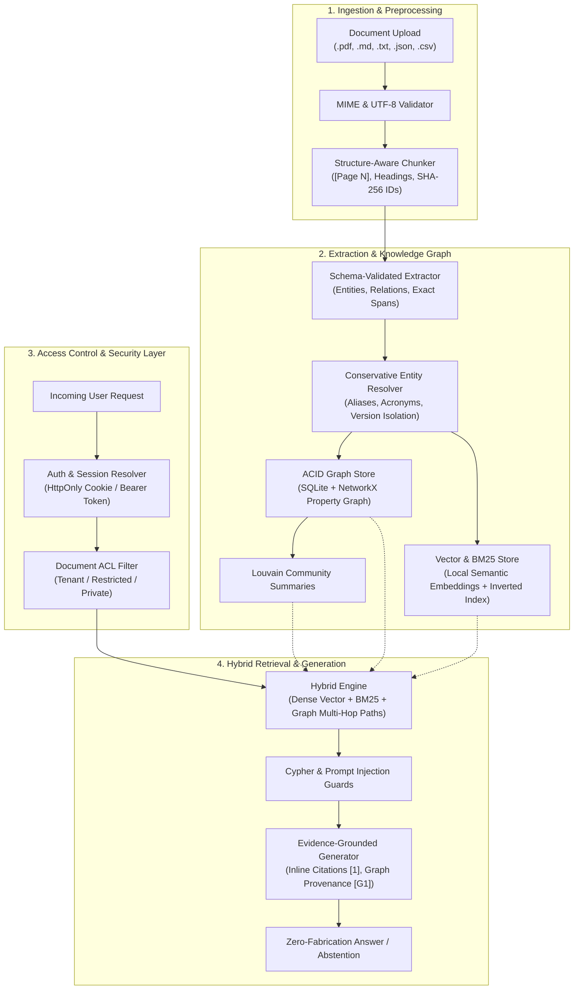

<div align="center">

# 🌐 Automated GraphRAG System
### Enterprise Knowledge Graph + Hybrid Vector/Lexical RAG with Grounded Multi-Hop Reasoning

[](https://www.python.org/)
[](https://fastapi.tiangolo.com/)
[](https://tailwindcss.com/)
[](https://docs.pytest.org/)
[](https://owasp.org/)
[](LICENSE)

*An evidence-grounded Automated GraphRAG platform combining structure-aware document ingestion, schema-validated entity/relationship extraction, conservative alias resolution, an ACID SQLite + NetworkX property graph, hybrid dense vector + BM25 retrieval, Louvain community detection, and zero-fabrication citation-backed answer generation.*

---

[Key Features](#-key-features) •
[Architecture](#-system-architecture) •
[UI Screenshots](#-user-interface--screenshots) •
[Default Credentials](#-default-accounts--credentials) •
[Quick Start](#-quick-start) •
[Feature Testing Guide](#-step-by-step-feature-testing-guide) •
[API Reference](#-api-reference) •
[Automated Tests](#-automated-tests--verification) •
[Push to GitHub Guide](#-how-to-push-to-github)

</div>

---

## 📌 Overview

**Automated GraphRAG** addresses the core failure modes of conventional vector-only RAG: fragmented context, blindness to cross-document cascades, relationship hallucination, and inability to answer multi-hop questions over time. 

By unifying **structure-aware document parsing**, a **conservative property knowledge graph**, and **hybrid dense + BM25 retrieval**, the system discovers connection paths across documents that share no lexical overlap with the query. Every synthesized claim is strictly grounded with inline citations (`[1]`, `[2]`) and graph path references (`[G1]`), with guaranteed zero-fabrication abstention when evidence is insufficient.

---

## 🖼️ User Interface & Screenshots

The platform features an enterprise-grade web interface styled with Tailwind CSS, supporting interactive knowledge graph exploration, evidence-grounded QA, document ingestion with granular access control, and live benchmark evaluation.

### 1. Interactive Knowledge Graph & Entity Resolution Explorer
*Visualizes interconnected entities, property relationships on an interactive radial-dot blueprint canvas, node inspector with verbatim source quotes, and tracked uncertain entity resolution matches.*


### 2. Evidence-Grounded Query & Multi-Hop Citation Workspace
*Synthesizes answers across disparate documents with strict inline citations (`[1]`, `[2]`), graph path provenance (`[G1]`), real-time latency telemetry, multi-hop reasoning chains, and Louvain community cluster summaries.*


### 3. Document Library, Ingestion Pipeline & Granular ACL
*Multi-format document parsing (`.md`, `.pdf`, `.txt`, `.json`, `.csv`) with structure-aware chunking, token tracking, and granular document-level Access Control Lists (Tenant-Wide, Restricted, Private).*


### 4. Comparative Evaluation: Vector Baseline vs. Hybrid GraphRAG
*Side-by-side empirical benchmark measuring Fact Recall (+15.6% uplift to 68.9%), Citation Accuracy (83.3%), Multi-Document Coverage (91.7%), and query latency trade-offs across complex multi-document test suites.*


---

## 🏗️ System Architecture



---

## ✨ Key Features

### 1. Multi-Format Structure-Aware Ingestion (`backend/ingestion.py`)
- Accepts `.md`, `.txt`, `.pdf` (`pypdf`), `.json`, and `.csv`.
- Validates MIME types, file sizes (`MAX_UPLOAD_SIZE_BYTES`), null-byte checks, and UTF-8 encoding.
- Preserves `[Page N]` markers and section hierarchy with deterministic SHA-256 `chunk_id`s and exact character offsets.

### 2. Schema-Validated Extraction & Provenance (`backend/extraction.py`)
- Strict type validation: `EntityType` (`ORGANIZATION`, `PERSON`, `SYSTEM`, `EVENT`, `LOCATION`, `METRIC`, `POLICY`, `TECHNOLOGY`, `CONCEPT`, `DATE`).
- Allowlisted `RelationshipType` (`DEPENDS_ON`, `CAUSED_BY`, `OPERATES`, `ACQUIRED`, `PARTNERED_WITH`, `REGULATED_BY`, `LOCATED_IN`, `DEVELOPED_BY`, `IMPACTS`, `REPORTED_METRIC`, `SUCCEEDED_BY`).
- Distinguishes explicitly asserted links (`is_inferred=False`) from clause-level contextual inferences (`is_inferred=True`).
- Retains verbatim `evidence_quote` spans and temporal markers for complete provenance.

### 3. Conservative Entity Resolution (`backend/entity_resolution.py`)
- Normalizes canonical keys and captures verified parenthetical aliases/acronyms (e.g., `Helios Payment Gateway (HPG)`).
- **Anti-Overmerging**: Explicitly holds back entities with distinct version qualifiers (`v2.4` vs `v1.9`) or regional zones (`US` vs `UK`) in `uncertain_matches` to prevent corrupted graph topology.

### 4. ACID Property Graph & Community Detection (`backend/graph_store.py`)
- SQLite relational persistence synchronized with `networkx.MultiDiGraph`.
- Re-indexing and document deletion execute clean cascading updates without orphaned nodes or duplicated edges.
- Runs Greedy Modularity / Louvain community detection to generate global thematic cluster summaries.

### 5. Hybrid Retrieval & Grounded Generation (`backend/retrieval.py`, `backend/generation.py`)
- Configurable strategies: `Hybrid GraphRAG`, `Vector + BM25 Baseline`, or `Graph-First Traversal`.
- Discovers multi-hop provenance paths across distinct documents, pulling in downstream causal evidence even with zero lexical overlap.
- Enforces strict factual grounding: every assertion is tied to source citations (`[1]`, `[2]`) or graph paths (`[G1]`), returning an honest abstention when evidence is insufficient.

### 6. Enterprise Authentication, RBAC & Document ACLs (`backend/auth.py`, `backend/security.py`)
- **PBKDF2-HMAC-SHA256** password hashing (310,000 iterations + 16-byte cryptographic salt).
- **Sliding-window login rate limiting** (5 failed attempts per 10-minute window) with uniform error messages to prevent account enumeration.
- **Server-side sessions** with `HttpOnly`, `SameSite=Lax` cookies, per-session CSRF token validation (`X-CSRF-Token`), and `Authorization: Bearer` compatibility.
- **Document-level Access Control (ACL)**: `visibility` (`tenant`, `restricted`, `private`), `allowed_roles`, and per-user `allowed_doc_ids`.
- **Pre-LLM Retrieval Filtering**: Unauthorized chunks, entities, and graph subgraphs are filtered out before retrieval, ensuring zero data leakage into LLM prompts.

---

## 👥 Default Accounts & Credentials

The system automatically initializes 3 default role-based accounts upon first startup:

| Role | Username | Email (Can be used to sign in) | Default Password | Permissions Summary |
| :--- | :--- | :--- | :--- | :--- |
| **Admin** | `admin` | `admin@graphrag.local` | `Admin@GraphRAG2026!` | **Full Access**: User administration, session revocation, security audit logs, document management & ACLs, query, graph explorer, evaluation. |
| **Analyst** | `analyst` | `analyst@graphrag.local` | `Analyst@GraphRAG2026!` | **Power User**: Ingest/delete documents, manage document ACLs, review uncertain matches, execute GraphRAG queries, run benchmarks. *(No user management)* |
| **Viewer** | `viewer` | `viewer@graphrag.local` | `Viewer@GraphRAG2026!` | **Read-Only**: Explore graph, inspect overview, and run queries **strictly restricted to authorized documents**. *(No upload, delete, or admin tools)* |

> 💡 **Developer Convenience**: The Sign-In screen includes one-click **Quick-Fill buttons** (*Admin*, *Analyst*, *Viewer*) for rapid local testing.

---

## 🚀 Quick Start

### Prerequisites
- **Python 3.10+**
- **Node.js 18+** *(Only required if modifying Tailwind CSS templates)*

### 1. Clone & Set Up Environment
```bash
# Clone the repository
git clone https://github.com/your-username/automated-graphrag.git
cd automated-graphrag

# Create and configure .env
cp .env.example .env
```

### 2. Install Python Dependencies
```bash
python -m pip install --upgrade pip
pip install -r requirements.txt
```

### 3. (Optional) Compile Tailwind CSS
If you edit frontend templates or Tailwind classes:
```bash
npm install
npm run build:css
```

### 4. Start the Application
You can launch the system using any of the provided launchers:

**Option A — Windows Batch Launcher (Recommended for Windows):**
```cmd
run.bat
```

**Option B — PowerShell Launcher:**
```powershell
./run.ps1
```

**Option C — Python Cross-Platform Launcher:**
```bash
python launch.py
```

*The launcher automatically initializes the database, resolves any blocked Windows/TCP ports (handling WinError 10013 / 10048), starts Uvicorn, and opens your default browser at **`http://127.0.0.1:8765`**.*

---

## 🧪 Step-by-Step Feature Testing Guide

### 1. Authentication & Security
1. Open `http://127.0.0.1:8765` in your browser. You will be redirected to `#login-view`.
2. Test the **Show/Hide password toggle** (eye icon).
3. Test invalid credentials; verify that uniform error alerts prevent account enumeration.
4. Click **Admin** quick-fill and click **Sign In**. Verify the `admin` badge and the **Users & RBAC** tab appear in the navbar.
5. Click the key icon in the header to verify the **Change Password** modal.

### 2. Document Ingestion & Sample Corpus
1. Go to the **Documents & Ingestion** tab.
2. Click **Load Enterprise Sample Corpus**.
   - Inspect the 3 enterprise documents ingested: Cloud Architecture, Incident `INC-2025-089`, and DORA Compliance Dossier.
3. Click **Inspect Chunks** on any document to verify structure-aware chunking, page markers, and token counts.
4. Click **Manage Access** on a document to test setting access visibility (`Tenant-Wide`, `Restricted`, or `Private`).

### 3. Knowledge Graph Explorer
1. Navigate to the **Graph Explorer** tab.
2. Search for an entity (e.g. `Helios` or `Aurelia`) or filter by **Entity Type** (`SYSTEM`, `EVENT`, `POLICY`).
3. Click any node in the graph (or in the entity table below) to inspect its aliases, confidence score, connected edges, and source evidence quotes.
4. In the **Multi-Hop Path Finder**, set:
   - **Source Entity**: `Incident INC-2025-089`
   - **Target Entity**: `Aurelia Financial Cloud`
   - Click **Find Shortest Path** to visualize the multi-hop causal chain.
5. Inspect the **Uncertain Matches Review** panel to observe held-back version conflicts.

### 4. Grounded QA Copilot
1. Open the **Query & Grounded QA** tab.
2. Select **Hybrid GraphRAG** mode.
3. Ask a multi-hop cross-document question:
   > *"What caused Incident INC-2025-089 on Helios Payment Gateway and what regulatory penalties or SLA impacts occurred?"*
4. Verify the synthesized answer contains:
   - Inline text citations `[1]`, `[2]` linking directly to document chunks.
   - Graph provenance tags `[G1]` highlighting the entity relationships used.
   - Execution telemetry breakdown (Vector Search, Graph Traversal, LLM synthesis).
5. Ask a question outside the corpus (e.g., *"What is the stock price of Mars Rover in 2035?"*) and confirm the system **abstains** (`Abstained: Insufficient Evidence`).

### 5. Access Control & RBAC Isolation
1. As **Admin**, restrict Document 3 by clicking **Manage Access**, unchecking the `viewer` role, and saving.
2. Click **Sign Out** and log in as **Viewer** (`viewer` / `Viewer@GraphRAG2026!`).
3. Notice:
   - The **Users & RBAC** tab is hidden.
   - The document upload panel is locked to read-only.
   - Restricted documents are invisible in the document list.
   - Subgraph exploration and queries by Viewer will **never leak** entities or citations from the restricted document.

### 6. User Management & Audit Logs (Admin Only)
1. Sign back in as **Admin** and open the **Users & RBAC** tab.
2. Click **+ Create User** to add a new user with custom document access scopes.
3. Test **Edit User**, **Revoke Sessions**, and **Disable User** (with built-in self-lockout protection for the current admin).
4. Review the **Security & Access Audit Log** at the bottom of the tab for complete forensic tracking (`auth.login.success`, `user.create`, `document.acl.update`).

### 7. Evaluation & Observability Benchmark
1. Go to the **Evaluation & Observability** tab.
2. Click **Run Evaluation Suite**.
3. Review the empirical benchmark comparing **Hybrid GraphRAG** vs. **Vector Baseline** across Fact Coverage, Entity Recall, Grounding Precision, and Latency.

---

## 📡 API Reference

All protected endpoints require an authenticated session cookie or `Authorization: Bearer <token>` / `X-API-Key`.

| Method | Endpoint | Description | Required Role / Permission |
| :--- | :--- | :--- | :--- |
| `POST` | `/api/auth/login` | Authenticate user & issue session cookie | Public |
| `POST` | `/api/auth/logout` | Revoke active session & clear cookie | Authenticated |
| `GET` | `/api/auth/whoami` | Retrieve active principal identity & roles | Authenticated |
| `POST` | `/api/auth/change-password` | Update current user password | Authenticated |
| `GET` | `/api/overview` | Dashboard summary metrics & distributions | `overview:read` |
| `GET` | `/api/documents` | List authorized documents for caller | `documents:read` |
| `POST` | `/api/documents/upload` | Upload & ingest document (`.md`, `.pdf`, etc.) | `documents:upload` |
| `POST` | `/api/documents/seed-demo` | Ingest synthetic enterprise demo corpus | `documents:upload` |
| `PUT` | `/api/documents/{doc_id}/acl` | Update document visibility & access control | `documents:acl` |
| `DELETE`| `/api/documents/{doc_id}` | Cascade delete document, chunks & orphaned graph nodes | `documents:delete` |
| `GET` | `/api/graph/subgraph` | Filtered property subgraph for authorized docs | `graph:read` |
| `GET` | `/api/graph/communities` | Retrieve Louvain community thematic summaries | `graph:read` |
| `POST` | `/api/query` | Execute grounded RAG query with citations | `query:execute` |
| `GET` | `/api/users` | List users with search & role filters | `users:read` (Admin) |
| `POST` | `/api/users` | Create new user with document scopes | `users:manage` (Admin) |
| `PATCH`| `/api/users/{user_id}` | Update role, status, or reset password | `users:manage` (Admin) |
| `GET` | `/api/audit-logs` | Retrieve forensic security audit event log | `audit:read` (Admin) |
| `POST` | `/api/evaluate` | Run benchmark: GraphRAG vs. Vector baseline | `evaluation:run` |

---

## 🧪 Automated Tests & Verification

The project includes an end-to-end integration and security test suite in `tests/test_graphrag_system.py`:

```bash
# Run the complete test suite
python -m pytest -v
```

### Verified Test Suites (11/11 Passing):
- `test_parsing_and_structure_aware_chunking`: Validates multi-format parsing and deterministic chunk spans.
- `test_extraction_and_malformed_llm_validation`: Schema validation and graceful JSON repair for LLM outputs.
- `test_entity_resolution_merges_aliases_and_holds_back_distinct_versions`: Anti-overmerging verification.
- `test_cypher_injection_and_prompt_injection_defenses`: CypherGuard and prompt injection defense barriers.
- `test_rbac_and_cross_tenant_isolation`: Multi-tenant data segregation.
- `test_idempotent_reindexing_multihop_query_and_cascade_deletion`: Clean cascade updates and graph sync.
- `test_frontend_tailwind_assets_and_accessibility_landmarks`: WAI-ARIA and Tailwind CSS asset validation.
- `test_authentication_login_session_csrf_and_logout`: Cookie sessions, CSRF token validation, and logout.
- `test_login_rate_limiting_throttling`: Sliding-window brute-force defense (HTTP 429).
- `test_user_management_rbac_escalation_defense_and_deactivation`: User administration and privilege defense.
- `test_document_level_acl_graph_traversal_and_citation_isolation`: Pre-LLM document ACL filtering across graph subgraphs, citations, and queries.

---

## 🔒 Security & Defense in Depth

1. **Password Security**: Cryptographic PBKDF2-HMAC-SHA256 with per-user salt and constant-time digest matching.
2. **Session Security**: Cryptographically random 256-bit session tokens stored as SHA-256 hashes; `HttpOnly` and `SameSite=Lax` cookies; strict CSRF verification on mutating requests.
3. **CypherGuard**: Parameterized Cypher execution preventing injection attacks against connected graph engines.
4. **PromptInjectionGuard**: Scans ingested chunks for instruction overrides, system prompt extraction, or adversarial jailbreaks.
5. **Pre-LLM Grounding Filter**: Restricts retrieval candidates to caller-authorized document IDs *before* hybrid search and graph traversal, preventing LLM prompt leakage.

---

## 📂 Project Structure

```text
Automated GraphRAG/
├── backend/
│   ├── auth.py              # PBKDF2 hashing, session management, ACL authorization, audit logs
│   ├── config.py            # Pydantic settings, Principal model, role-permission matrix
│   ├── database.py          # SQLite schema, migrations, connection pool, default user seeding
│   ├── entity_resolution.py # Canonical key normalization, alias capture, version conflict hold-back
│   ├── extraction.py        # Schema-validated entity and relationship extraction
│   ├── generation.py        # Grounded citation generation, prompt guard, honest abstention
│   ├── graph_store.py       # ACID SQLite + NetworkX graph store, Louvain communities
│   ├── ingestion.py         # Multi-format structure-aware chunking (.md, .pdf, .txt, etc.)
│   ├── main.py              # FastAPI endpoints, auth routes, document ACLs, user management
│   ├── pipeline.py          # Document indexing and graph synchronization pipeline
│   ├── retrieval.py         # Hybrid retrieval router (Dense vector + BM25 + Multi-hop graph)
│   ├── schemas.py           # Pydantic request/response models and extraction schemas
│   ├── security.py          # Session and API-key principal resolver, RBAC guards
│   └── vector_store.py      # Dense semantic embeddings + sparse BM25 index
├── frontend/
│   ├── app.js               # Reactive single-page application controller, state, and API integration
│   ├── graph-renderer.js    # Canvas-based interactive Knowledge Graph visualization
│   ├── index.html           # Semantic HTML5 UI with Tailwind CSS and accessibility landmarks
│   ├── input.css            # Tailwind CSS source directives and custom components
│   ├── styles.css           # Compiled production Tailwind CSS stylesheet
│   └── ui-components.js     # Modal managers, toast notifications, and UI helper widgets
├── docs/
│   └── screenshots/         # UI showcase images for GitHub repository display
├── data/                    # SQLite database storage (graphrag.db)
├── tests/
│   └── test_graphrag_system.py # Complete 11-suite end-to-end integration and security tests
├── .env.example             # Documented environment configuration template
├── .gitignore               # Standard ignore rules for Python, Node, data, and secrets
├── launch.py                # Cross-platform one-command launcher with port resolution
├── package.json             # Frontend build scripts and Tailwind CSS dependencies
├── requirements.txt         # Production Python dependencies
├── run.bat                  # One-click Windows batch launcher
├── run.ps1                  # One-click Windows PowerShell launcher
└── tailwind.config.js       # Tailwind CSS configuration and theme tokens
```

---

## 📤 How to Push to GitHub

Follow these steps to initialize and push this project to your GitHub repository:

```bash
# 1. Initialize Git (if not already initialized)
git init

# 2. Add all files (the included .gitignore will safely ignore node_modules, .env, and local database files)
git add .

# 3. Create initial commit
git commit -m "feat: complete automated graphrag enterprise system with rbac, document acl, and tailwind ui"

# 4. Set default branch to main
git branch -M main

# 5. Link your remote GitHub repository (replace with your repository URL)
git remote add origin https://github.com/your-username/automated-graphrag.git

# 6. Push to GitHub
git push -u origin main
```

---

## 📄 License

This project is licensed under the [MIT License](LICENSE).
