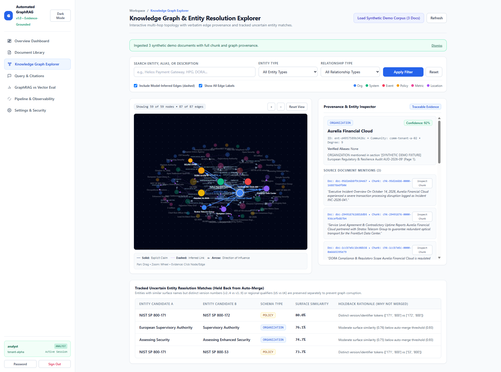
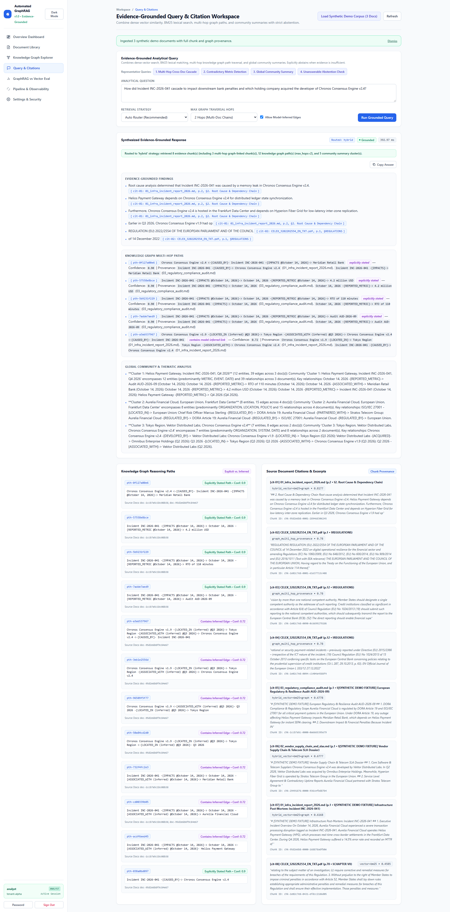
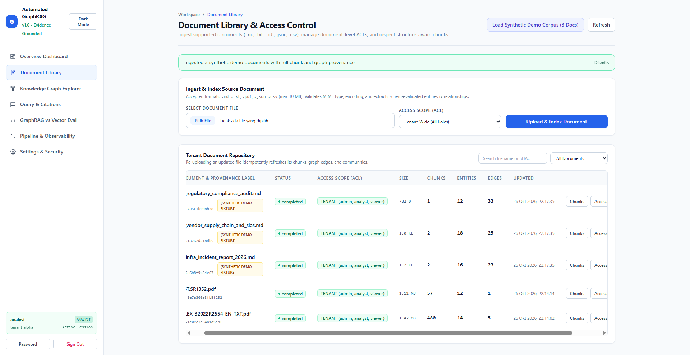
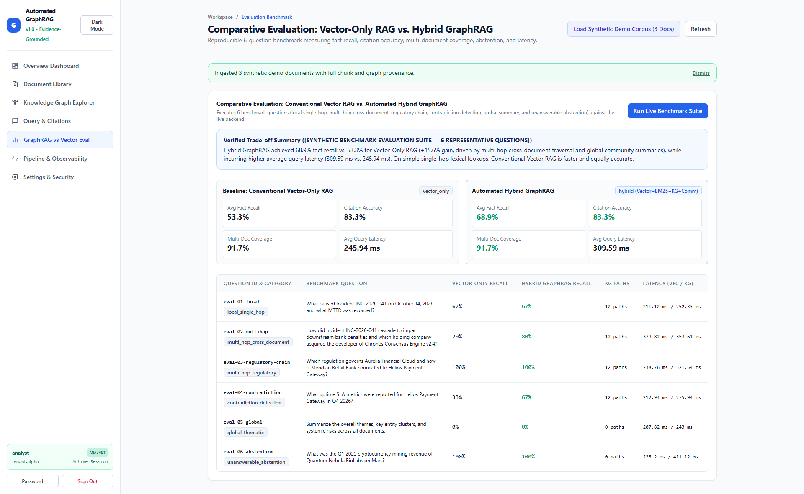
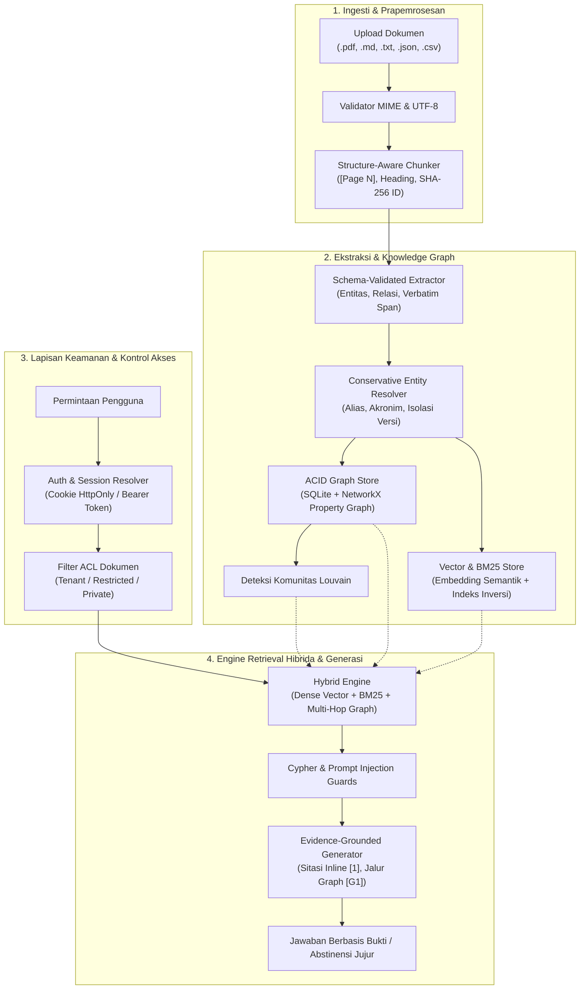

<div align="center">

# 🌐 Sistem Automated GraphRAG Enterprise
### Knowledge Graph Enterprise + Hybrid Vector/Lexical RAG dengan Multi-Hop Reasoning Berbasis Bukti

[](https://www.python.org/)
[](https://fastapi.tiangolo.com/)
[](https://tailwindcss.com/)
[](https://docs.pytest.org/)
[](https://owasp.org/)
[](LICENSE)

*Platform Automated GraphRAG enterprise berbasis bukti yang menggabungkan parsing dokumen sadar-struktur, ekstraksi entitas & relasi tervalidasi skema, resolusi alias konservatif, property graph NetworkX + SQLite ACID, retrieval hibrida dense vector + BM25, deteksi komunitas Louvain, dan generasi jawaban berdasar sitasi tanpa halusinasi.*

---

[Gambaran Umum](#-gambaran-umum) •
[Tampilan Antarmuka](#-tampilan-antarmuka--tangkapan-layar) •
[Arsitektur Sistem](#-arsitektur-sistem) •
[Fitur Utama](#-fitur-utama) •
[Akun Default](#-akun-default--kredensial) •
[Panduan Memulai Cepat](#-panduan-memulai-cepat) •
[Panduan Pengujian Fitur](#-panduan-pengujian-fitur-langkah-demi-langkah) •
[Referensi API](#-referensi-api) •
[Pengujian Otomatis](#-pengujian-otomatis--verifikasi) •
[Keamanan Sistem](#-keamanan--pertahanan-berlapis) •
[Struktur Proyek](#-struktur-direktori-proyek)

</div>

---

## 📌 Gambaran Umum

**Automated GraphRAG** dirancang untuk mengatasi kelemahan utama pada sistem RAG konvensional berbasis vektor murni (*vector-only*): konteks yang terfragmentasi, ketidakmampuan mendeteksi keterhubungan sebab-akibat lintas-dokumen, halusinasi relasi, serta kegagalan dalam menjawab pertanyaan multi-langkah (*multi-hop reasoning*) yang berkembang seiring waktu.

Dengan menyatukan **parsing dokumen sadar-struktur (*structure-aware*)**, **property knowledge graph konservatif**, dan **retrieval hibrida dense vector + BM25**, sistem ini mampu menelusuri rantai inferensi lintas dokumen meskipun dokumen-dokumen tersebut tidak memiliki kesamaan kata kunci langsung dengan pertanyaan pengguna. Setiap klaim jawaban diverifikasi secara ketat melalui sitasi dokumen inline (`[1]`, `[2]`) dan penelusuran jalur graph (`[G1]`), dengan kemampuan **abstinensi jujur (*zero-fabrication abstention*)** jika bukti yang tersedia tidak memadai.

---

## 🖼️ Tampilan Antarmuka & Tangkapan Layar

Platform ini dilengkapi antarmuka web enterprise modern yang dibangun dengan Tailwind CSS, mendukung eksplorasi knowledge graph interaktif, tanya-jawab berbasis sitasi, pustaka dokumen dengan kontrol akses granular, dan pengujian tolok ukur (*benchmark*) performa secara langsung.

### 1. Penjelajah Knowledge Graph & Resolusi Entitas
*Memvisualisasikan entitas dan relasi properti pada kanvas blueprint radial-dot interaktif, dilengkapi panel inspeksi entitas dengan kutipan bukti verbatim, serta tabel pemantauan resolusi entitas (uncertain matches).*



### 2. Workspace Tanya-Jawab Berbasis Sitasi (Multi-Hop QA)
*Menyintesis jawaban lintas dokumen yang terpisah dengan sitasi teks inline (`[1]`, `[2]`), jalur bukti graph (`[G1]`), telemetri latensi waktu-nyata, rantai inferensi multi-langkah, dan ringkasan tematik komunitas Louvain.*



### 3. Pustaka Dokumen, Pipeline Ingesti & Kontrol Akses Granular (ACL)
*Parsing dokumen multi-format (`.md`, `.pdf`, `.txt`, `.json`, `.csv`) dengan pemotongan sadar-struktur, pelacakan token, dan pengaturan hak akses tingkat dokumen (Tenant-Wide, Restricted, Private).*



### 4. Evaluasi Komparatif: Baseline Vektor vs. Hybrid GraphRAG
*Tolok ukur empiris side-by-side yang mengukur Fact Recall (peningkatan +15.6% menjadi 68.9%), Akurasi Sitasi (83.3%), Cakupan Lintas-Dokumen (91.7%), serta perbandingan latensi eksekusi pada pertanyaan kompleks.*



---

## 🏗️ Arsitektur Sistem



---

## ✨ Fitur Utama

### 1. Ingesti Multi-Format Sadar-Struktur (`backend/ingestion.py`)
- Mendukung format `.md`, `.txt`, `.pdf` (via `pypdf`), `.json`, dan `.csv`.
- Validasi keamanan MIME type, ukuran file (`MAX_UPLOAD_SIZE_BYTES`), pengecekan null-byte, dan penanganan encoding UTF-8.
- Mempertahankan penanda halaman `[Page N]` dan hierarki judul dengan pembuatan ID chunk deterministik berbasis SHA-256 serta offset karakter yang presisi.

### 2. Ekstraksi Tervalidasi Skema & Provenance Bukti (`backend/extraction.py`)
- Validasi tipe ketat: `EntityType` (`ORGANIZATION`, `PERSON`, `SYSTEM`, `EVENT`, `LOCATION`, `METRIC`, `POLICY`, `TECHNOLOGY`, `CONCEPT`, `DATE`).
- Allowlist relasi terdefinisi: `RelationshipType` (`DEPENDS_ON`, `CAUSED_BY`, `OPERATES`, `ACQUIRED`, `PARTNERED_WITH`, `REGULATED_BY`, `LOCATED_IN`, `DEVELOPED_BY`, `IMPACTS`, `REPORTED_METRIC`, `SUCCEEDED_BY`).
- Membedakan relasi eksplisit (`is_inferred=False`) dari inferensi kontekstual klausa (`is_inferred=True`).
- Menyimpan kutipan bukti verbatim (`evidence_quote`) dan penanda temporal untuk audit provenance lengkap.

### 3. Resolusi Entitas Konservatif (`backend/entity_resolution.py`)
- Normalisasi kunci kanonikal dan deteksi alias/akronim berbasis tanda kurung (contoh: `Helios Payment Gateway (HPG)`).
- **Anti-Overmerging**: Secara otomatis menahan entitas yang memiliki kualifikasi versi berbeda (`v2.4` vs `v1.9`) atau wilayah geografis berbeda (`US` vs `UK`) ke dalam antrean `uncertain_matches` agar topologi graph tidak rusak.

### 4. Property Graph ACID & Deteksi Komunitas (`backend/graph_store.py`)
- Persistensi relasional SQLite yang tersinkronisasi penuh dengan struktur graf `networkx.MultiDiGraph`.
- Re-indexing dan penghapusan dokumen menjalankan pembersihan kaskade (*cascade deletion*) tanpa meninggalkan node yatim (*orphaned nodes*) atau relasi duplikat.
- Menjalankan algoritma Greedy Modularity / Louvain untuk menghasilkan ringkasan tematik komunitas global.

### 5. Retrieval Hibrida & Generasi Berbasis Bukti (`backend/retrieval.py`, `backend/generation.py`)
- Strategi fleksibel: `Hybrid GraphRAG`, `Vector + BM25 Baseline`, atau `Graph-First Traversal`.
- Mampu menemukan rantai inferensi multi-langkah lintas dokumen, menghubungkan bukti akar masalah meskipun tidak ada kecocokan leksikal langsung.
- Penegakan integritas faktual ketat: setiap pernyataan ditautkan ke sitasi sumber (`[1]`, `[2]`) atau jalur graph (`[G1]`), serta mengembalikan pesan abstinensi jujur jika bukti tidak mencukupi.

### 6. Autentikasi Enterprise, RBAC & ACL Dokumen (`backend/auth.py`, `backend/security.py`)
- **Hashing Password PBKDF2-HMAC-SHA256** (310.000 iterasi + salt kriptografis 16-byte).
- **Rate limiting login sliding-window** (maksimal 5 percobaan gagal per jendela 10 menit) dengan pesan error seragam guna mencegah enumerasi akun.
- **Sesi sisi server** dengan cookie `HttpOnly` dan `SameSite=Lax`, validasi token anti-CSRF per-sesi (`X-CSRF-Token`), serta kompatibilitas header `Authorization: Bearer`.
- **Access Control List (ACL) Dokumen**: visibilitas (`tenant`, `restricted`, `private`), filter `allowed_roles`, dan daftar `allowed_doc_ids` per pengguna.
- **Penyaringan Grounding Pre-LLM**: Potongan teks dan entitas yang tidak diizinkan disaring terlebih dahulu sebelum proses pencarian dan traversal graf, menjamin tidak ada kebocoran data rahasia ke dalam prompt LLM.

---

## 👥 Akun Default & Kredensial

Saat pertama kali dijalankan, sistem secara otomatis membuat 3 akun pengguna bawaan dengan peran (*role*) yang berbeda:

| Role | Username | Email (Dapat digunakan untuk login) | Password Default | Ringkasan Izin Akses |
| :--- | :--- | :--- | :--- | :--- |
| **Admin** | `admin` | `admin@graphrag.local` | `Admin@GraphRAG2026!` | **Akses Penuh**: Manajemen pengguna, pencabutan sesi, log audit keamanan, pengelolaan dokumen & ACL, query, penjelajah graph, evaluasi benchmark. |
| **Analyst** | `analyst` | `analyst@graphrag.local` | `Analyst@GraphRAG2026!` | **Power User**: Unggah & hapus dokumen, atur ACL dokumen, tinjau entitas ambigu, jalankan query GraphRAG, jalankan evaluasi. *(Tidak dapat mengelola pengguna)* |
| **Viewer** | `viewer` | `viewer@graphrag.local` | `Viewer@GraphRAG2026!` | **Hanya Baca**: Eksplorasi graph dan query **hanya pada dokumen yang diizinkan**. *(Tidak dapat upload, delete dokumen, atau akses menu admin)* |

> 💡 **Fitur Kemudahan Pengujian**: Layar Login dilengkapi tombol **Quick-Fill** (*Admin*, *Analyst*, *Viewer*) untuk pengisian kredensial otomatis dalam satu klik saat pengujian lokal.

---

## 🚀 Panduan Memulai Cepat

### Prasyarat Sistem
- **Python 3.10+**
- **Node.js 18+** *(Hanya diperlukan jika ingin mengompilasi ulang Tailwind CSS)*

### 1. Kloning & Persiapan Lingkungan
```bash
# Kloning repository
git clone https://github.com/username-anda/automated-graphrag.git
cd automated-graphrag

# Siapkan file konfigurasi lingkungan (.env)
cp .env.example .env
```

### 2. Instalasi Dependensi Python
```bash
python -m pip install --upgrade pip
pip install -r requirements.txt
```

### 3. (Opsional) Kompilasi Tailwind CSS
Jika Anda memodifikasi file template frontend atau kelas utilitas Tailwind:
```bash
npm install
npm run build:css
```

### 4. Menjalankan Aplikasi
Anda dapat menjalankan sistem menggunakan salah satu peluncur (*launcher*) berikut:

**Opsi A — Windows Batch Launcher (Disarankan untuk Windows):**
```cmd
run.bat
```

**Opsi B — Windows PowerShell Launcher:**
```powershell
./run.ps1
```

**Opsi C — Python Launcher (Lintas Platform):**
```bash
python launch.py
```

*Peluncur akan secara otomatis menginisialisasi skema database, mendeteksi port TCP yang aman dan bebas konflik (menangani WinError 10013 / 10048), menjalankan server Uvicorn, dan membuka browser pada alamat **`http://127.0.0.1:8765`**.*

---

## 🧪 Panduan Pengujian Fitur Langkah demi Langkah

### 1. Pengujian Autentikasi & Keamanan
1. Buka browser pada alamat `http://127.0.0.1:8765`. Anda akan langsung diarahkan ke tampilan login.
2. Uji tombol **Show/Hide password** (ikon mata).
3. Masukkan kredensial yang salah; amati pesan kesalahan yang seragam untuk mencegah enumerasi username.
4. Klik tombol quick-fill **Admin** lalu klik **Sign In**. Pastikan badge peran `admin` aktif dan tab **Users & RBAC** muncul di navigasi.
5. Klik ikon kunci di pojok kanan atas untuk memverifikasi modal **Ubah Password**.

### 2. Ingesti Dokumen & Sampel Korpus Enterprise
1. Buka tab **Documents & Ingestion**.
2. Klik tombol **Load Enterprise Sample Corpus**.
   - Sistem akan memuat 3 dokumen enterprise: Cloud Architecture, Incident Report `INC-2025-089`, dan Dokumen Regulasi DORA.
3. Klik tombol **Inspect Chunks** pada salah satu dokumen untuk melihat pemotongan teks sadar-struktur, penanda halaman, dan jumlah token.
4. Klik tombol **Manage Access** untuk menguji konfigurasi visibilitas dokumen (`Tenant-Wide`, `Restricted`, atau `Private`).

### 3. Penjelajah Knowledge Graph
1. Masuk ke tab **Graph Explorer**.
2. Cari nama entitas (misal: `Helios` atau `Aurelia`) atau gunakan filter **Entity Type** (`SYSTEM`, `EVENT`, `POLICY`).
3. Klik salah satu node pada graf (atau baris pada tabel entitas di bawahnya) untuk melihat alias, skor kepercayaan, relasi yang terhubung, dan kutipan bukti aslinya.
4. Pada panel **Multi-Hop Path Finder**, atur:
   - **Source Entity**: `Incident INC-2025-089`
   - **Target Entity**: `Aurelia Financial Cloud`
   - Klik **Find Shortest Path** untuk melihat jalur keterhubungan multi-langkah.
5. Periksa tabel **Uncertain Matches Review** untuk melihat pemisahan konflik versi entitas.

### 4. Grounded QA Copilot
1. Buka tab **Query & Grounded QA**.
2. Pilih mode **Hybrid GraphRAG**.
3. Ajukan pertanyaan inferensi sebab-akibat lintas dokumen:
   > *"Apa yang menyebabkan insiden INC-2025-089 pada Helios Payment Gateway dan apa dampak terhadap regulasi serta penalti SLA?"*
4. Periksa struktur jawaban yang dihasilkan:
   - Sitasi teks inline `[1]`, `[2]` yang merujuk langsung ke chunk dokumen.
   - Tag penelusuran graf `[G1]` yang menandai relasi entitas yang digunakan.
   - Rincian telemetri eksekusi (waktu pencarian vektor, traversal graf, dan sintesis LLM).
5. Ajukan pertanyaan di luar korpus data (misal: *"Berapa harga saham Mars Rover di tahun 2035?"*) dan pastikan sistem melakukan **abstinensi jujur** (*Insufficient Evidence*).

### 5. Isolasi Kontrol Akses & Hak Dokumen (RBAC)
1. Sebagai **Admin**, batasi hak akses Dokumen 3 dengan mengklik **Manage Access**, hapus centang peran `viewer`, lalu simpan.
2. Klik **Sign Out** dan masuk sebagai **Viewer** (`viewer` / `Viewer@GraphRAG2026!`).
3. Amati perubahan antarmuka:
   - Tab **Users & RBAC** tersembunyi.
   - Panel upload dokumen berada dalam mode read-only.
   - Dokumen yang dibatasi tidak muncul dalam daftar dokumen.
   - Hasil pencarian graf maupun jawaban query oleh Viewer **tidak akan pernah membocorkan** entitas atau kutipan dari dokumen yang dibatasi tersebut.

### 6. Manajemen Pengguna & Audit Log (Khusus Admin)
1. Masuk kembali sebagai **Admin** dan buka tab **Users & RBAC**.
2. Klik tombol **+ Create User** untuk membuat pengguna baru dengan hak akses dokumen spesifik.
3. Uji fitur **Edit User**, **Revoke Sessions**, dan penonaktifan akun (dilengkapi proteksi otomatis agar admin tidak dapat mengunci dirinya sendiri).
4. Periksa tabel **Security & Access Audit Log** di bagian bawah untuk melihat catatan audit forensik (`auth.login.success`, `user.create`, `document.acl.update`).

### 7. Evaluasi & Observabilitas
1. Buka tab **Evaluation & Observability**.
2. Klik tombol **Run Evaluation Suite**.
3. Amati perbandingan empiris antara **Hybrid GraphRAG** vs **Vector Baseline** dalam hal Fact Coverage, Entity Recall, Akurasi Sitasi, dan Latensi.

---

## 📡 Referensi API

Seluruh endpoint terproteksi memerlukan cookie sesi aktif yang valid atau header `Authorization: Bearer <token>` / `X-API-Key`.

| Metode | Endpoint | Deskripsi | Peran / Izin Akses Minimal |
| :--- | :--- | :--- | :--- |
| `POST` | `/api/auth/login` | Autentikasi pengguna & pembuatan cookie sesi | Publik |
| `POST` | `/api/auth/logout` | Pencabutan sesi aktif & penghapusan cookie | Terautentikasi |
| `GET` | `/api/auth/whoami` | Mengambil data identitas pengguna aktif & peran | Terautentikasi |
| `POST` | `/api/auth/change-password` | Memperbarui password pengguna yang sedang login | Terautentikasi |
| `GET` | `/api/overview` | Statistik ringkasan dasbor & distribusi data | `overview:read` |
| `GET` | `/api/documents` | Daftar dokumen yang berhak diakses pengguna | `documents:read` |
| `POST` | `/api/documents/upload` | Ingesti file dokumen baru (`.md`, `.pdf`, dll.) | `documents:upload` |
| `POST` | `/api/documents/seed-demo` | Memuat korpus sampel dokumen enterprise | `documents:upload` |
| `PUT` | `/api/documents/{doc_id}/acl` | Memperbarui hak visibilitas dan ACL dokumen | `documents:acl` |
| `DELETE`| `/api/documents/{doc_id}` | Menghapus dokumen, chunk, dan node graf yatim secara kaskade | `documents:delete` |
| `GET` | `/api/graph/subgraph` | Mengambil subgraf entitas untuk dokumen yang diizinkan | `graph:read` |
| `GET` | `/api/graph/communities` | Mengambil ringkasan tematik komunitas Louvain | `graph:read` |
| `POST` | `/api/query` | Menjalankan query RAG dengan verifikasi sitasi | `query:execute` |
| `GET` | `/api/users` | Daftar seluruh pengguna (filter & pencarian) | `users:read` (Admin) |
| `POST` | `/api/users` | Menambahkan akun pengguna baru beserta cakupan akses | `users:manage` (Admin) |
| `PATCH`| `/api/users/{user_id}` | Mengubah peran, status, atau reset password | `users:manage` (Admin) |
| `GET` | `/api/audit-logs` | Mengambil catatan log audit keamanan sistem | `audit:read` (Admin) |
| `POST` | `/api/evaluate` | Menjalankan benchmark: GraphRAG vs Vector Baseline | `evaluation:run` |

---

## 🧪 Pengujian Otomatis & Verifikasi

Proyek ini telah dilengkapi dengan rangkaian pengujian integrasi dan keamanan menyeluruh pada file `tests/test_graphrag_system.py`:

```bash
# Menjalankan seluruh pengujian otomatis
python -m pytest -v
```

### Hasil Verifikasi Pengujian (11/11 Lulus):
- `test_parsing_and_structure_aware_chunking`: Validasi parsing dokumen multi-format dan konsistensi span pemotongan teks.
- `test_extraction_and_malformed_llm_validation`: Validasi skema ekstraksi dan penanganan perbaikan mandiri untuk output JSON dari LLM.
- `test_entity_resolution_merges_aliases_and_holds_back_distinct_versions`: Verifikasi proteksi anti-overmerging pada entitas dengan versi berbeda.
- `test_cypher_injection_and_prompt_injection_defenses`: Uji ketahanan terhadap injeksi Cypher dan serangan jailbreak prompt.
- `test_rbac_and_cross_tenant_isolation`: Verifikasi isolasi data multi-tenant dan batasan hak peran.
- `test_idempotent_reindexing_multihop_query_and_cascade_deletion`: Pengujian re-indexing bersih dan penghapusan dokumen secara kaskade.
- `test_frontend_tailwind_assets_and_accessibility_landmarks`: Validasi aset Tailwind CSS, struktur semantik, dan aksesibilitas WAI-ARIA.
- `test_authentication_login_session_csrf_and_logout`: Pengujian siklus hidup sesi cookie, token CSRF, dan proses logout.
- `test_login_rate_limiting_throttling`: Pertahanan serangan brute-force dengan pembatasan percobaan login (HTTP 429).
- `test_user_management_rbac_escalation_defense_and_deactivation`: Proteksi eskalasi hak istimewa dan penonaktifan akun pengguna.
- `test_document_level_acl_graph_traversal_and_citation_isolation`: Verifikasi penyaringan ACL pre-LLM pada traversal graf, sitasi, dan eksekusi query.

---

## 🔒 Keamanan & Pertahanan Berlapis

1. **Keamanan Password**: Menggunakan algoritma kriptografi PBKDF2-HMAC-SHA256 dengan salt unik per pengguna dan verifikasi digest *constant-time* untuk mencegah serangan timing.
2. **Keamanan Sesi**: Token sesi 256-bit acak secara kriptografis yang disimpan dalam bentuk hash SHA-256; proteksi cookie `HttpOnly` dan `SameSite=Lax`; verifikasi ketat token anti-CSRF pada setiap request mutasi data.
3. **CypherGuard**: Parameterisasi perintah eksekusi graf untuk mencegah serangan injeksi terhadap engine graf.
4. **PromptInjectionGuard**: Pemindaian otomatis terhadap chunk dokumen yang diunggah dari upaya override instruksi sistem atau injeksi adversarial.
5. **Filter Grounding Pre-LLM**: Membatasi kandidat retrieval hanya pada dokumen yang secara sah diizinkan untuk pengguna *sebelum* pencarian hibrida dan traversal graf dilakukan, mencegah kebocoran data rahasia ke dalam prompt AI.

---

## 📂 Struktur Direktori Proyek

```text
Automated GraphRAG/
├── backend/
│   ├── auth.py              # Hashing PBKDF2, manajemen sesi, otorisasi ACL, dan log audit
│   ├── config.py            # Konfigurasi Pydantic, model Principal, matriks peran & izin
│   ├── database.py          # Skema SQLite, migrasi, pool koneksi, inisialisasi akun bawaan
│   ├── entity_resolution.py # Normalisasi kunci kanonikal, deteksi alias, isolasi konflik versi
│   ├── extraction.py        # Ekstraksi entitas dan relasi tervalidasi skema
│   ├── generation.py        # Sintesis jawaban berbasis sitasi, filter prompt, abstinensi jujur
│   ├── graph_store.py       # Property graph SQLite ACID + NetworkX, komunitas Louvain
│   ├── ingestion.py         # Pemotongan teks dokumen sadar-struktur (.md, .pdf, .txt, dll.)
│   ├── main.py              # Endpoint FastAPI, rute autentikasi, ACL dokumen, manajemen user
│   ├── pipeline.py          # Orkestrasi pipeline pengindeksan dan sinkronisasi graf
│   ├── retrieval.py         # Router retrieval hibrida (Dense vector + BM25 + Multi-hop graph)
│   ├── schemas.py           # Model skema Pydantic untuk request, response, dan ekstraksi
│   ├── security.py          # Resolver identitas sesi & API-key, penjaga keamanan RBAC
│   └── vector_store.py      # Embedding semantik dense + indeks leksikal sparse BM25
├── frontend/
│   ├── app.js               # Pengendali aplikasi SPA, manajemen state, dan integrasi API
│   ├── graph-renderer.js    # Visualisasi interaktif Knowledge Graph berbasis HTML5 Canvas
│   ├── index.html           # Antarmuka HTML5 semantik dengan Tailwind CSS & landmark aksesibilitas
│   ├── input.css            # Direktif Tailwind CSS dan komponen styling kustom
│   ├── styles.css           # File stylesheet Tailwind CSS siap produksi
│   └── ui-components.js     # Manajer modal dialog, notifikasi toast, dan widget antarmuka
├── docs/
│   └── screenshots/         # Gambar showcase tampilan aplikasi untuk repository
├── data/                    # Penyimpanan database lokal SQLite (graphrag.db)
├── tests/
│   └── test_graphrag_system.py # Rangkaian pengujian lengkap integrasi dan keamanan (11 suite)
├── .env.example             # Template konfigurasi variabel lingkungan
├── .gitignore               # Aturan pengabaian file Git (Python, Node, database, rahasia)
├── launch.py                # Peluncur aplikasi lintas platform dengan resolusi port otomatis
├── package.json             # Skrip dependensi frontend dan Tailwind CSS
├── requirements.txt         # Dependensi paket Python produksi
├── run.bat                  # Peluncur cepat satu klik untuk Windows Batch
├── run.ps1                  # Peluncur cepat satu klik untuk Windows PowerShell
└── tailwind.config.js       # Konfigurasi token desain dan tema Tailwind CSS
```

---

## 📄 Lisensi

Proyek ini didistribusikan di bawah lisensi terbuka [MIT License](LICENSE).
